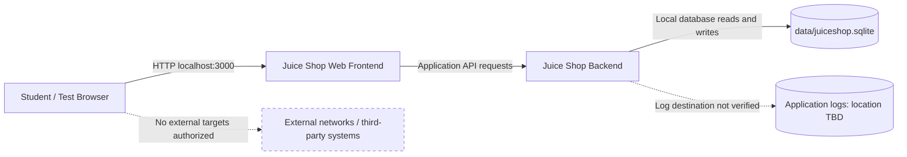

# STRIDE Threat Register — OWASP Juice Shop Local Lab

**Status: Preliminary lab-specific assessment.** This document describes the local OWASP Juice Shop instance observed on the assessor's Kali Linux WSL2 environment. It is not evidence of RabTech authorization. Testing beyond basic service verification remains subject to written approval and the agreed Rules of Engagement.

## 1. Verified lab facts

- Application: OWASP Juice Shop.
- Environment: Kali Linux under WSL2 on Windows 11.
- Local URL tested: `http://127.0.0.1:3000`.
- Service: TCP port 3000; an HTTP `200 OK` response was observed on 2026-11-05.
- Database file observed: `~/juice-shop/data/juiceshop.sqlite` (270,336 bytes in the directory listing on 2026-11-05).
- Network exposure: the process/socket inspection showed a listener on `*:3000`. Windows WSL Hyper-V firewall was enabled with `DefaultInboundAction=Block` and `LoopbackEnabled=True`; the enabled inbound TCP rule listing showed no allow rule for local port 3000. Local access to `127.0.0.1:3000` returned HTTP 200.
- Separate-device test on 2026-11-05: from the small laptop (test device) on the same Wi-Fi, `Test-NetConnection` to the big laptop (Juice Shop host), TCP port 3000, returned `TcpTestSucceeded=False` and `PingSucceeded=False`. A browser attempt to access the host's port 3000 did not load.
- Follow-up firewall evidence: Windows Firewall blocked-packet logging was enabled on Domain, Private, and Public profiles. `pfirewall.log` recorded DROP ICMP traffic from the small laptop to the big laptop and DROP UDP traffic from the same source to the same destination on port 137. A targeted search found no TCP/3000 DROP entry. Hyper-V firewall was reconfirmed enabled with default inbound action Block, outbound action Allow, and loopback enabled.
- Interpretation: the service was not reachable from that test device at that time, and Windows Firewall dropped some traffic from that device. The logs do not establish that Windows Firewall dropped the specific TCP/3000 connection. Wi-Fi client isolation, routing, Hyper-V policy, or another network control may explain the failure; not all possible network paths are proven isolated.
- Application log location and retention: not verified.
- Data contents: not inspected for this inventory; do not assume all records are synthetic.

## 2. STRIDE threat register

| ID | STRIDE category | Example abuse case | Asset / boundary | Likelihood | Impact | Initial risk | Mitigation priority | Mitigation / validation | Safe stop condition |
|---|---|---|---|---|---|---|---|---|---|
| S-01 | Spoofing | A user attempts to impersonate another account using a forged or stolen session token | Browser-to-application authentication boundary | Medium | High | High | **P1 — High** | Use only approved synthetic accounts; validate server-side session handling; never reuse real credentials | Stop if real credentials or third-party identity systems are involved |
| T-01 | Tampering | A user modifies a request to alter another user's training data | Browser/API-to-application boundary; SQLite-backed application data | Medium | Medium | Medium | **P2 — Moderate** | Use synthetic data; validate input and enforce server-side authorization; preserve a clean lab copy | Stop if data outside the approved test dataset could be changed |
| R-01 | Repudiation | An application action cannot be attributed to an actor or timestamp | Application-to-audit/logging boundary | Medium | Medium | Medium | **P2 — Moderate** | Confirm available audit events and timestamps; protect logs from unauthorized modification | Stop if testing would require deleting or altering real logs |
| I-01 | Information disclosure | An unauthenticated request exposes a record, configuration detail, or debug information | HTTP/API responses and SQLite-backed data | Medium | High | High | **P1 — High** | Use benign requests and synthetic data; redact secrets and personal information; avoid uncontrolled extraction | Stop if real personal data, secrets, or unrelated files appear |
| D-01 | Denial of service | Repeated requests exhaust application resources | Application availability boundary | Low (without load testing) | High | Medium | **P2 — Moderate** | Do not load-test or stress-test; use low-rate manual checks only if approved; monitor for instability | Stop at any unexpected slowdown, crash, or resource spike |
| E-01 | Elevation of privilege | A low-privilege user accesses an administrator-only function | Application role/authorization boundary | Medium | High | High | **P1 — High** | Use approved synthetic roles; verify server-side authorization on protected actions | Stop if an action could affect real users, host settings, or external services |

### Mitigation priority ranking

The priorities below are analyst-assigned planning priorities based on the documented likelihood and impact estimates. They are not results of exploit testing.

1. **P1 — High mitigation priority: S-01 Spoofing, I-01 Information disclosure, E-01 Elevation of privilege.** Prioritize account/session protections, protection of sensitive data, and server-side authorization. These scenarios combine medium likelihood with high impact.
2. **P2 — Moderate mitigation priority: T-01 Tampering, R-01 Repudiation, D-01 Denial of service.** Preserve data integrity, ensure useful auditability, and protect availability. Denial of service has low assessed likelihood in the absence of load testing but high potential impact; stress testing remains prohibited unless separately authorized.

## 3. Data-flow diagram

The diagram reflects the observed local application and database file. The internal application components are shown at a high level; exact runtime data flows and log destinations have not yet been verified.

## 4. Trust boundaries

1. **Browser-to-application boundary:** HTTP requests and user-supplied input are untrusted.
2. **Application-to-database boundary:** database access should occur through the application; direct database changes are outside routine testing unless explicitly approved.
3. **Application-to-logging boundary:** log destination, contents, and retention have not yet been verified.
4. **Lab-to-external-network boundary:** external systems are excluded from this assessment. A same-Wi-Fi test from the small laptop could not reach TCP port 3000 on the big laptop, and the browser request did not load. Windows Firewall logged dropped ICMP and UDP traffic from that laptop, but no TCP/3000 DROP entry was found. This supports restricted reachability from the tested device and confirms some traffic was dropped by Windows Firewall, but the cause of the specific TCP/3000 failure and all other possible network paths remain unverified.

## 5. Outstanding verification

- The separate-device reachability test was completed on 2026-11-05 and failed to connect/load. Windows Firewall logs show dropped ICMP and UDP traffic from the test laptop, but no TCP/3000 DROP entry. Record this as unsuccessful reachability and evidence of some firewall drops, not proof that the host firewall caused the specific TCP/3000 failure or that every network path is isolated.
- Confirm application log location and retention without exposing secrets.
- Confirm whether the database contains only approved training data.
- Obtain RabTech/supervisor written authorization defining the exact target, tools, time window, rate limits, contact, and evidence-retention rules.

**Authorization reminder:** This register is a planning and risk-analysis document, not permission to test. Do not conduct further security testing until written scope approval is recorded.
